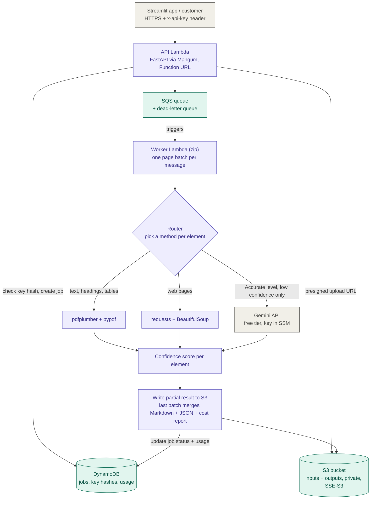

# Scope 2 design note (v1)

**Goal:** one service that takes a PDF or URL and returns Markdown + JSON, with a confidence score and a "how it was produced" label on every element. Free tools only, deployed on AWS with one command.

## Architecture

**Cross-cutting:** SAM template (`sam deploy` / `sam delete`), least-privilege IAM, CloudWatch logs + 2-3 alarms, SSM Parameter Store for secrets.

## Why each choice (and why it is free)

| Choice | Why | Free because |
|---|---|---|
| Async jobs | Large PDFs take minutes | No cost |
| Lambda for API and worker | No servers, no idle cost | Always free: 1M requests, 400K GB-seconds a month |
| Zip Lambda, no Docker | Docker cannot be installed on my laptop; zip Lambdas are built in AWS CloudShell | CloudShell has no extra charge |
| Page batches | One Lambda run is capped at 15 minutes | No cost |
| SQS + dead-letter queue | Buffers bursts, retries, catches bad files | 1M requests a month free |
| DynamoDB | Jobs, key hashes, usage | 25 GB always free |
| S3 with SSE-S3 | Private, encrypted | Covered by credits at this size |
| Gemini free tier | AI only on elements that need it | Free tier, no card |
| SAM | `sam deploy` and `sam delete` | Free |

## Router (fill from my Scope 1 comparison)

| Element | First method | Escalate to AI when | Scope 1 evidence |
|---|---|---|---|
| Headings | pdfplumber font sizes | Level looks inconsistent | TODO |
| Text | pdfplumber / pypdf | Column order looks scrambled | TODO |
| Tables | pdfplumber | Row or column counts are inconsistent | TODO |
| Formulas | none | Always (Accurate level) | TODO |
| Key-value pairs | Rules / regex | Pairs not found | TODO |
| Images | Detect and crop | Accurate level: caption | TODO |

## Confidence score (0 to 1)

Parser agreement + structural checks (table columns consistent, heading levels valid, formula parses) + AI quality check result. Thresholds are calibrated on my test set.

## Quality levels

- **Standard:** parsers only, no AI calls.
- **Accurate:** parsers + Gemini on low-confidence elements + an AI quality check.

## Known limitations

- The cloud worker does not run Docling (it needs a Docker image). Docling appears as a Scope 1 baseline in the benchmark.
- Gemini free tier is rate-limited and non-commercial, so a real product needs the paid tier. The business case is priced at paid list prices.
- TODO: anything else I cut.
